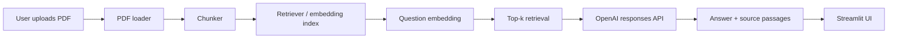

# DocuQuery

DocuQuery is a Streamlit application for asking natural-language questions about uploaded PDF documents. It extracts text from PDF files, chunks the content, embeds the chunks with a sentence-transformers model, retrieves the most relevant passages, and answers questions using only the retrieved evidence.

## Problem statement

Many organizations and students work with PDFs that contain long reports, instructions, research notes, and technical summaries. Reading them manually is time-consuming, and generic chatbots often answer without showing the passages that support their claims. DocuQuery addresses that problem with a compact retrieval-augmented generation (RAG) workflow that keeps evidence visible and traceable.

## Main features

- Upload a PDF and validate it before processing
- Extract readable text from text-based PDFs
- Split content into overlapping word-based chunks
- Create embeddings with Sentence Transformers
- Rank relevant passages through cosine similarity in vector space
- Answer questions with evidence-grounded responses
- Show support passages and chunk IDs for inspection
- Handle missing configuration and provider failures gracefully
- Keep the working document in memory during the current session

## Example workflow

1. Open the app.
2. Upload a PDF.
3. Click Index document.
4. Ask a question such as: "What problem does this report solve?"
5. Review the answer and inspect the supporting source passages.

## Architecture



## Technology stack

- Python 3.11+
- Streamlit
- PyMuPDF
- Sentence Transformers
- NumPy
- OpenAI Python SDK
- python-dotenv
- pytest

## What is RAG?

Retrieval-augmented generation combines document retrieval with language-model generation. Instead of relying solely on the model's general knowledge, the app retrieves the most relevant chunks from the uploaded document and feeds them into the model as evidence. This makes the answer more grounded and easier to audit.

## Embeddings and vector similarity

Embeddings are numerical representations of text that capture semantic meaning. Similar passages produce nearby vectors. This application stores chunk embeddings in memory and uses cosine similarity to compare a question embedding with the document chunk embeddings. A higher score means the chunk is more semantically similar to the question, but the score is only an informational clue, not proof of correctness.

## Repository structure

```text
docuquery-ai/
├── app.py
├── rag/
│   ├── __init__.py
│   ├── pdf_loader.py
│   ├── chunker.py
│   ├── retriever.py
│   └── answerer.py
├── tests/
│   ├── test_pdf_loader.py
│   ├── test_chunker.py
│   ├── test_retriever.py
│   └── test_answerer.py
├── sample_docs/
│   └── .gitkeep
├── .env.example
├── .gitignore
├── requirements.txt
├── README.md
└── .github/
    └── workflows/
        └── tests.yml
```

## Prerequisites

- Python 3.11 or newer
- A local virtual environment is recommended
- Access to the internet for installing dependencies and downloading the default sentence-transformers model
- A valid OpenAI API key if you want to use the real answer-generation model

## Virtual environment setup

```bash
python -m venv .venv
# Windows PowerShell
.venv\Scripts\Activate.ps1
# macOS/Linux
source .venv/bin/activate
```

## Install dependencies

```bash
python -m pip install --upgrade pip
python -m pip install -r requirements.txt
```

## API configuration

Create a local `.env` file from `.env.example`:

```bash
copy .env.example .env
```

Then set these values:

```env
OPENAI_API_KEY=your_key_here
OPENAI_MODEL=gpt-4o-mini
```

The application does not hardcode credentials and keeps them out of Git using `.gitignore`.

## Run the application

```bash
streamlit run app.py
```

This starts the DocuQuery interface in the browser. The active document and indexed chunks live in Streamlit session state and are not persisted permanently.

## Run tests

```bash
pytest -q
```

## How to use the app

1. Upload a PDF.
2. Click Index document.
3. Confirm the document is indexed successfully.
4. Type a question about the document.
5. Click Ask.
6. Read the answer and inspect the supporting passages.
7. Review the chunk IDs and similarity scores.

## Limitations

- In-memory storage means the indexed document is lost when the process restarts.
- The default MVP supports text-based PDFs only; scanned PDFs without OCR are not supported.
- The retriever relies on the default sentence-transformers model, which may require a model download on the first run.
- OpenAI API usage requires valid credentials, billing, and provider access.
- Similarity scores indicate lexical/semantic closeness, not certainty.
- The app is intended as a local demonstration, not a production authentication system.

## Troubleshooting

- If the PDF is rejected: check that the file is valid, non-empty, and not too large.
- If the app says no text was extracted: the PDF may be scanned or image-only.
- If the model fails to load: confirm that the environment has internet access and storage for the sentence-transformers model.
- If answer generation fails: confirm `OPENAI_API_KEY` and `OPENAI_MODEL` are set correctly.
- If tests fail: run `pytest -q` again after checking the stack trace and fix the root cause.

## Future improvements

- Add OCR for scanned PDFs
- Add page-level metadata and stronger provenance tracking
- Add persistent storage and optional document history
- Add model fallback logic and a local offline option
- Improve citation validation and answer post-processing
- Add user authentication and secure hosting patterns for real deployment

## Screenshots

The environment allows real application testing, but screenshots should be captured from the live Streamlit page when the app is launched. If a browser is available, open the local app URL and take screenshots of the upload workflow, indexing result, and answer/source section. This README intentionally avoids fabricated screenshots or deployment URLs.

## Deployment status

This application is verified for local execution in a development environment. It is not a production deployment and should not be exposed publicly without securing credentials, upload limits, and API cost controls.
